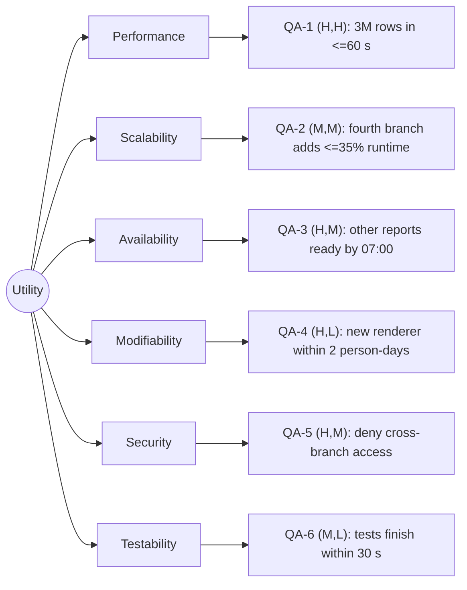

# Quality-attribute scenarios: Angkor Mart monthly sales report

## Stakeholders
- **Head-office analyst:** views and exports consolidated monthly reports.
- **Branch manager (PNH, REP, BTB):** views reports for their own branch only.
- **Finance director:** receives a notification when reports are ready.
- **Operations person:** runs the job and handles failures.
- **Development team:** tests and maintains the system.

## Scenarios

| ID | Attribute | Source | Stimulus | Artifact | Environment | Response | Response measure | Rank |
|---|---|---|---|---|---|---|---|---|
| QA-1 | Performance | Monthly scheduler | Starts report generation for about 3 million rows | Report engine | Normal operation; assumed 8-core server and SSD | Processes data and writes reports | Finish within 60 seconds; median wall-clock time over 5 runs after 2 warm-ups | (H,H) |
| QA-2 | Scalability | Head-office analyst | Adds a fourth branch with comparable monthly data | Ingestion and report engine | Normal operation | Processes the new branch without a major redesign | Runtime increases by no more than 35%; compare median of 5 runs | (M,M) |
| QA-3 | Availability | Operations person | REP branch file is delayed by 2 hours due to link failure | Ingestion and reporting workflow | One branch is unavailable temporarily | Generates reports from available branch data and marks REP as pending | PNH and BTB reports ready by 07:00 in 5 simulated failure runs | (H,M) |
| QA-4 | Modifiability | Development team | Adds a new report export format | Rendering component | Normal development environment | Adds a renderer without changing report calculation logic | Complete within 2 person-days and change at most 5 existing production source files | (H,L) |
| QA-5 | Security | Branch manager | Attempts to access another branch's report | Authentication and authorization | Authenticated user | Denies access and records the denied attempt | 100 of 100 unauthorized attempts are denied and logged | (H,M) |
| QA-6 | Testability | Development team | Runs automated report-engine tests | Report engine and tests | CI environment | Tests run without real branch systems or production data | All report-engine unit tests finish within 30 seconds, measured by CI | (M,L) |

## Rank justifications
- **QA-1 (H,H):** The morning deadline and roughly 3 million rows make speed important and technically challenging.
- **QA-2 (M,M):** The design should support future branches, although the first release has only three.
- **QA-3 (H,M):** A delayed branch must not prevent other branches from receiving reports on time.
- **QA-4 (H,L):** New output formats should not require rewriting the calculation logic.
- **QA-5 (H,M):** Branch sales data is confidential and managers must see only their own branch.
- **QA-6 (M,L):** Automated tests reduce regression risk and make maintenance easier.

## Assumptions
- A1: The 8-core server and SSD are assumptions to confirm with the client.
- A2: The full-month volume is approximately 3 million rows, as stated in the brief.
- A3: The 60-second, 35%, 2-person-day, and 30-second targets are proposed measurable targets, not existing measured results.
- A4: A partial report must clearly identify missing branch data; it must not appear complete.
- A5: Branch managers are authenticated and authorization is enforced server-side.

## Utility tree

## Architectural drivers
- QA-1 (H,H): performance.
- QA-3 (H,M): availability during a branch-link failure.
- QA-5 (H,M): branch-level access control.
